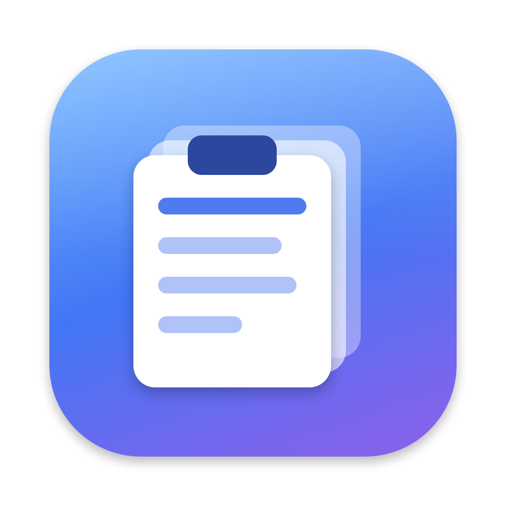
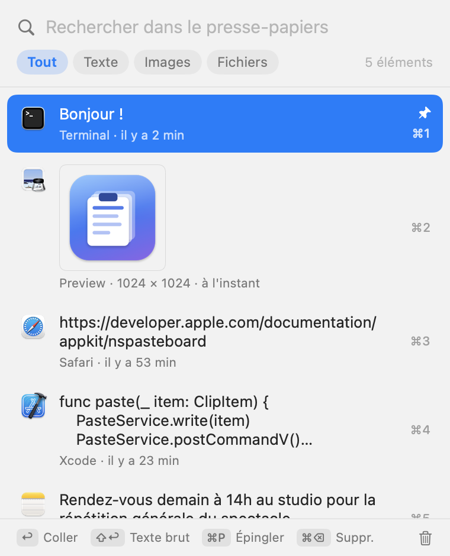
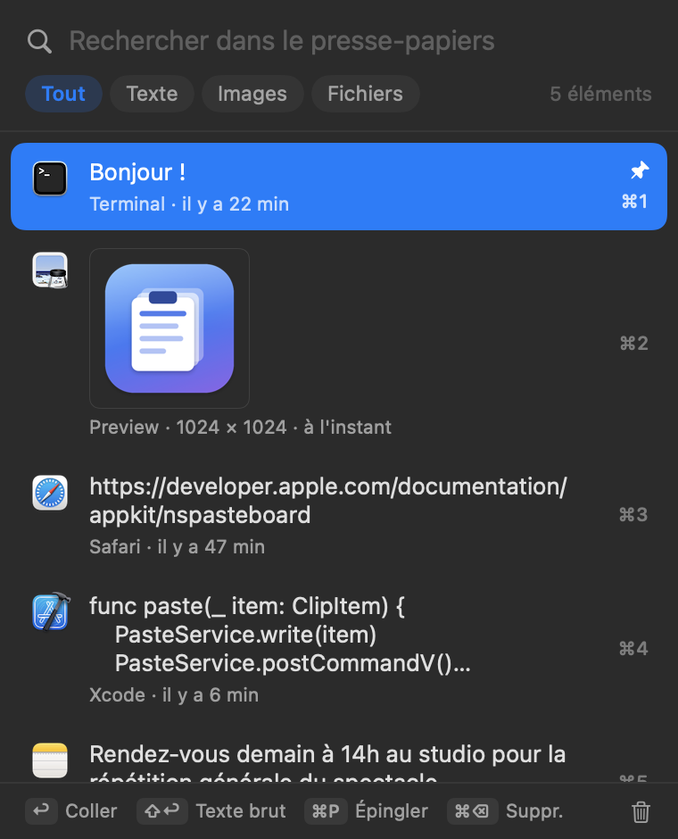

<p align="center"></p>

# PostClip

Historique du presse-papiers pour macOS, façon Windows (Win+V) : **⌘V** ouvre un panneau avec tout ce qui a été copié (texte, images, fichiers) et on choisit quoi coller.

<p align="center">
  
  
</p>

Application native (Swift, AppKit + SwiftUI), sans dépendance, pour macOS 13 et plus (Intel et Apple Silicon).

## Installation

```bash
./build.sh install
```

Nécessite Xcode ou les Command Line Tools (`xcode-select --install`). Puis autoriser PostClip dans **Réglages Système → Confidentialité et sécurité → Accessibilité** (nécessaire pour intercepter ⌘V et coller). L'app est signée « ad hoc » : après chaque rebuild il faut ré-accorder cette autorisation.

## Utilisation

| Touche | Action |
|---|---|
| ⌘V | Ouvre le panneau (⌘V à nouveau : élément suivant) |
| ↑ ↓ | Naviguer |
| ↩ / clic | Coller |
| ⇧↩ | Coller en texte brut |
| ⌘1 … ⌘9 | Coller directement l'élément n |
| ⇥ | Filtre suivant (Tout / Texte / Images / Fichiers) |
| ⌘P | Épingler (les épinglés restent en haut et ne sont jamais effacés) |
| ⌘⌫ | Supprimer l'élément |
| esc | Fermer |
| Taper du texte | Rechercher |

Menu dans la barre des menus : choix du raccourci (⌘V ou ⇧⌘V), ouverture au démarrage, effacer l'historique.

## Détails

- Ressources : un contrôle du `changeCount` du presse-papiers toutes les 0,5 s (≈ 0 % CPU), pas d'icône dans le Dock.
- Les mots de passe copiés depuis un gestionnaire (types `org.nspasteboard.ConcealedType`) ne sont **jamais** enregistrés ; dans ce cas ⌘V colle normalement.
- Historique : 100 éléments (hors épinglés), stocké dans `~/Library/Application Support/PostClip/`.
- Si l'élément choisi est déjà le contenu actuel du presse-papiers, il est collé tel quel (mise en forme riche conservée).
